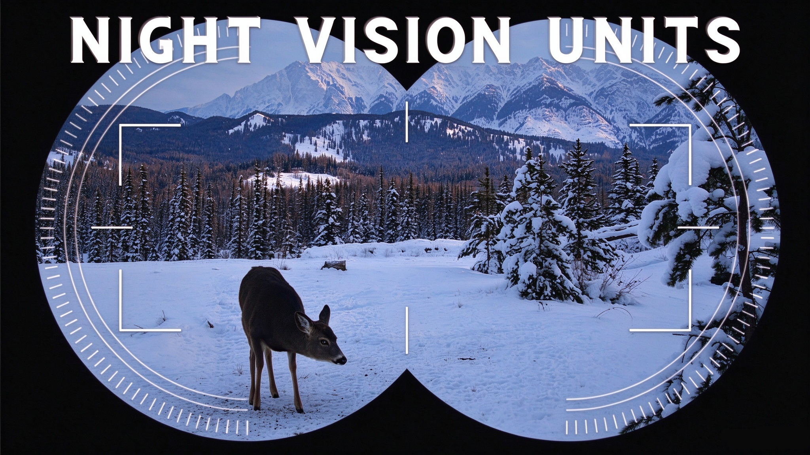

# l4d2-night-vision-flashlight

将手电筒变为夜视仪（无滤镜）

Turn a flashlight into a night vision device (no filter)

本 mod 修改自下面 mod

https://steamcommunity.com/sharedfiles/filedetails/?id=3298975358

# 改动

1. 移除原有的内置 `Urik Game Menu` 菜单，更换为游戏原生菜单项并精简项目
2. 修复在移动时视野中心有白色雾状物体上下跳动的问题

# 游戏自身问题

部分材质/物体变黑：某些贴图参数自身不适配手电筒

# mod 自身短板

1. 手电筒只有中间一小块：按下 ESC 手电筒即可填充满你的屏幕
2. 枪口开火闪烁消失：默认关闭，自行开启
3. 设置不会保存：故意为之，重新开始一个地图后重置设置
4. 不要与类似 mod 一起订阅！！
5. 不要与修改游戏暂停界面的 mod 一起订阅！！
6. 不要同时订阅原 mod！！

# 下载使用

进入 [releases](https://github.com/Little-Data/l4d2-night-vision-flashlight/releases) 页面

将文件解压

将 `vpk` 文件放入 `<Left 4 Dead 2游戏目录>\left4dead2\addons` 中

# 目录说明

除了 `no-pause-menu` 文件夹为不带暂停菜单选项版本的目录，其余文件为 vpk 内容