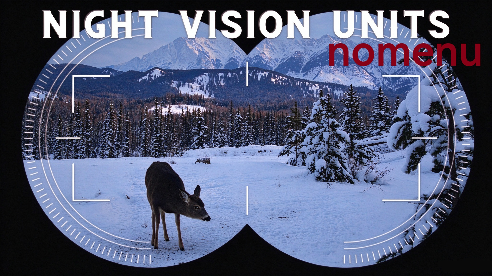

# night vision flashlight (no menu)

将手电筒变为夜视仪（无滤镜），不带暂停菜单选项的版本。

Turn a flashlight into a night vision device (no filter), without the pause-menu options.

## 与主版本的区别

主版本会替换 `resource/ui/l4d360ui/ingamemainmenu.res`，在暂停菜单上叠加“手电亮度 / 手电角度 / 手电距离 / 枪口闪光”滑条和“踢出玩家”按钮。

本版本**不包含** `resource/ui/`，暂停菜单完全是游戏原生界面：

- 没有任何叠加控件，也不会与修改暂停界面的其它 mod 冲突
- 所有参数固定为 `src/scripts/vscripts/director_base_addon.nut` 里的默认值
  - 手电亮度 `r_flashlightconstant` = 0.2
  - 手电角度 `r_flashlightfov` = 110
  - 手电距离 `r_flashlightfar` = 2200
  - 枪口闪光 `r_flashlightmuzzleflash` = 0（关闭）

想改参数，编辑该 `.nut` 即可。

## 安装

把 `night_vision_flashlight_nomenu.vpk` 放入 `<Left 4 Dead 2游戏目录>\left4dead2\addons`。

不要与主版本或原 mod 同时订阅（三者的文件名/标题不同，但功能会互相覆盖）。

## 已知问题

- 手电筒只有中间一小块：按 ESC 开关一次暂停菜单，手电筒即可填满屏幕
- 部分材质/物体变黑：某些贴图参数自身不适配手电筒
- 参数不会保存：每次进入地图都会重置为上面的默认值
